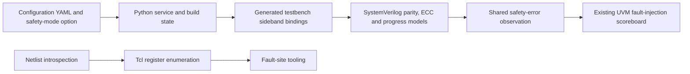

# NoC engineering contribution research

Reviewed 2026-10-29 for Michael Coulter. This report accompanies the
[achievement library](arachne-noc-contributions.md) and granular normalized records.
It explains scope, evolution, attribution, reconciliation and validation limits.

## Scope and method

The read-only product checkout is
`/Users/miccou01/GitProjects/sysip_shared_ai/workspaces/arachne-noc/slot_01/checkout/arachne_noc`,
branch `dev`, HEAD `c13c1beb89b07b46afd963706bb5d941ea4d36d0`. It is non-shallow.
The product worktree was clean at the start of inspection. No fetch, checkout
change, product edit, module/environment activation, build, simulator, formal run,
remote acceptance, publication or external upload occurred.

| Coverage measure | Captured result |
| --- | ---: |
| Locally available refs inventoried | 2,316 |
| All locally reachable commit objects | 101,139 |
| Selected HEAD ancestry | 89,162 |
| Michael-authored objects | 22 |
| Ordinary authored commits | 20 |
| Ordinary commits in / outside selected HEAD | 13 / 7 |
| Distinct ordinary stable patch identities | 17 |
| Stash working-tree / empty index objects | 1 / 1 |
| Other-author objects with Michael as committer | 0 |
| Current source snapshots / distinct paths | 28 / 28 |

The author search checked names/emails for `Coulter` and the `miccou` account,
finding the Arm email and one host-local email under Michael’s same author name.
Ordinary author dates run from November 3, 2020 through December 17, 2024;
the August 2026 objects are stashed state. This is not proof of continuous project
tenure, exact rotation dates, title changes or shipping dates. Local history does
not guarantee remote freshness or include unreachable/deleted Git objects.

All 20 ordinary authored diffs were examined through their implementation-bearing
changes, including minor maintenance and repeated/reapplied patches. Source and
generated YAML collateral were inspected for configuration context; their presence
does not establish personal authorship of every generated element. Both stash
objects were separately reviewed. Current blobs, historical additions/removals,
selected other-author diffs and surviving-line blame provide the evolution context.
The immutable capture retains all authored-object diffs and raw output/blob hashes.
Text extracts normalize line endings and escape non-UTF-8 bytes explicitly.

Stable patch IDs use `--no-renames` consistently. The seven release objects have
five identities, none matching the 49 nonmerge HEAD changes to their loader path.
Their absent ancestry and bounded patch comparison do not exclude differently
shaped equivalents or squashes. Patch counts and surviving-line counts are not
accomplishment counts or percentages of product ownership.

## Purpose, architecture and use cases

The repository combines configurable SystemVerilog NoC IP, Python parameter/RTL
generation, stitched designs and testbench bindings, UVM/VIP traffic simulation,
fault-site tooling, implementation flows and release collateral. Relevant use cases
include configuring protocol endpoints, testing traffic and data integrity,
injecting faults, observing corruption/non-progress and validating configuration-tool
compatibility on product release histories.

The diagram shows the historical safety-integration path, not sole authorship or a
claim that these legacy models remain instantiated in the current top-level flow.

Michael’s work demonstrates hardware protocol reasoning expressed through software
generation and verification infrastructure: sideband meanings, byte strobes and
validity, request/completion handshakes, outstanding IDs, age/state bookkeeping,
bit-level ECC encoding and hierarchical netlist traversal. It does not establish
ownership of the entire NoC, generation engine, UVM/VIP library or safety framework.

## Contribution evolution and practical outcomes

| Theme | Personal implementation and engineering result | Attribution / current-state boundary |
| --- | --- | --- |
| Parity models | Initial strobe-aware odd-parity generation/checking; read request/response extension; byte-level read-data parity and sideband offsets | Existing write request/response models and later protocol attributes include colleagues’ work |
| ECC | 32-bit chunk encoding, syndrome/error indicators and aggregate error integration across protocol branches | Later correction vectors, strobe fixes and actual correction integration are colleague work |
| Progress monitoring | AHB low-ready timeout; ID-aware AXI read tracking generalized to read/write completion; specific combinational-state latch correction | Colleague read beat-counter evolution and later split retained separately |
| Fault-injection integration | Python service/build option propagation, generated sideband bindings, protection-aware payload checking and UVM safety observation | Framework/scoreboard existed before Michael; only his integration and bounded modification are claimed |
| Register enumeration | Replaced fixed one-/two-dimensional cases with dimension-driven recursive traversal, enabling three-dimensional arrays | Initial walker and later tied-off-bit filtering/targeting are colleague contributions |
| Release setup | Configuration-tool module selection across older release histories, including correction of malformed version input | One-line maintenance; not creation of the end-to-end flow or proof of passing runs |

The legacy model sources remain in the selected tree. A later colleague’s
`cb3d526eb8f49e7ed3e09fcb146aea535587417a` removes their top-level instances and
legacy safety aggregation in August 2022. Current top-level observation uses FMU
interrupts. Thus a surviving module or blame entry cannot establish active current
top-level use. Historical implementation remains valuable experience.

## Complete authored-object map

Dates below are author milestones. Full hashes, author/committer identities,
containing local branches, messages, paths, patch identities and exact diffs are
preserved in the [history inventory](../sources/originals/src-arachne-history-2026-10-29/history-inventory.json)
and [diff capture](../sources/originals/src-arachne-history-2026-10-29/authored-diffs.md).
Abbreviations in this table are unique among captured authored objects.

| Object | Author date | Classification and contribution |
| --- | --- | --- |
| `16654dee97f7` | 2020-11-03 | HEAD; adds report-distribution email, retained as minor maintenance |
| `4df3354cc2c1` | 2020-11-05 | HEAD; generalizes multidimensional register enumeration |
| `492593a8f1b7` | 2020-12-09 | HEAD; initial parity models and configuration/generation/fault-injection integration |
| `8452bb85684a` | 2021-01-25 | HEAD; read request/response extension and protected-address slicing |
| `41d2221e7973` | 2021-01-28 | HEAD; reapplies the reverted read extension, same patch identity |
| `0061d5b19fa5` | 2021-01-29 | HEAD; adjusts protected address slice |
| `ff3fcf4dd41f` | 2021-01-29 | HEAD; read-data parity, binding changes and invalid-lane stimulus choice |
| `d8e7d9edefe1` | 2021-02-02 | HEAD; further protected-address slicing adjustment |
| `3ba56bea53a1` | 2021-02-19 | HEAD; AHB hang model, safety observation and scoreboard window |
| `2cb79d4081f5` | 2021-02-24 | HEAD; ECC models and aggregate error integration |
| `5d88abb38036` | 2021-03-26 | HEAD; AXI read hang tracking and interface parameters |
| `c22154dd2c2f` | 2021-04-07 | HEAD; generalizes AXI read/write progress monitor |
| `996cb7d4e7b7` | 2021-04-08 | HEAD; fixes incomplete idle-state assignment |
| `81dabe34f1c4` | 2024-12-09 | Other history; tool-version selection containing malformed prefix |
| `ce7563ed91e6` | 2024-12-09 | Other history; corrects version value |
| `5047992d67b8` | 2024-12-09 | Other history; release-module selection |
| `4ecbc2408500` | 2024-12-09 | Other history; same patch identity as preceding selection |
| `2971e359debd` | 2024-12-10 | Other history; release-module selection from a different baseline |
| `c4454008e9b4` | 2024-12-16 | Other history; release-module selection |
| `25e56dce89fd` | 2024-12-17 | Other history; same patch identity as preceding selection |
| `2ffec6bd4c81` | 2026-08-13 | Stash working tree; private debugging candidate, not delivered feature credit |
| `d9cbdcbc1751` | 2026-08-13 | Empty stash index snapshot; no independent implementation |

## Significant historical and attribution decisions

- **ECC ownership:** Original generator/checker introduction belongs to Michael.
  Later strobe indexing and correction integration belong to a colleague. The
  original detailed outputs were not consumed by his interface integration.
- **Hang monitor lineage:** Michael’s generic AXI tracker survives through a rename
  to the write model. The later read beat-counter implementation is colleague work.
- **Specific debugging:** The idle-state assignment is a concrete correction to
  latch-causing incomplete combinational assignment. No clean lint or synthesis
  run is inferred.
- **Register extraction:** The generalized enumeration is Michael’s refactor of an
  existing walker. Later filtering of tied-off array bits remains separate.
- **Framework ownership:** The fault-injection scripts and UVM scoreboard predate
  his integration. His output connections and delay adjustment do not make the
  entire framework his creation.
- **History heuristics:** Small/deleted files can produce spurious predecessors
  with automatic rename following. Explicit additions/removals and selected rename
  diffs were checked; captured path histories disable rename inference.
- **Stashed debugging:** The five-file patch guards missing routes, aligns OWO
  access-map/credit target sets and compares numeric clock frequencies for SDC.
  It has no ordinary landed commit or recovered passing-test evidence and remains
  private. It does not expand the earlier OWO wizard’s ownership to hardware IP.

## Quantities, impact and execution boundaries

| Evidence | Defensible interpretation | Unsupported inference |
| --- | --- | --- |
| Eight-bit read-parity groups at the inspected setting | Concrete data/sideband granularity | Fault-detection coverage or silicon protection guarantee |
| 32-bit ECC chunks | Algorithm/model scope | Exhaustive ECC correctness, current correction ownership or certification |
| Old one-/two-dimensional cases replaced | Added support for three-dimensional register arrays | Measured site-count increase, time saving or unlimited scale |
| AHB subject says 1,000; actual macro 100,000, later 400,000 | Source-authoritative configurable timeout | Fixed 1,000-cycle detection latency or measured speedup |
| Scoreboard delay 1,000 → 5,000 | Changed observation/reporting configuration | Fivefold performance improvement or measured safety latency |
| Tcl recursion limit 64,000 | Chosen recursion accommodation | A benchmark, throughput or supported-register-count guarantee |
| `repeat=100`, `num_txs=1000` | Intended simulation settings | Completed campaigns, successful transactions or passing tests |
| Seven commits titled “Testing” | Seven version-selection objects, five patch identities | Seven tested products, seven features or successful regressions |

The meaningful verified outcomes are capability and integration changes: additional
model observations, shared read/write monitoring, generated protection-sideband
connections and multidimensional register listing. No product tests, simulations,
formal checks, coverage runs or performance experiments were executed. No new
PPA, certification, customer/revenue or quantified productivity outcome is claimed.

## Reconciliation with existing career knowledge

The previous database had 95 records, 304 facts and 34 registered sources. This
expansion adds five accomplishment records, one project context and two contextual
skills, reaching **103 records, 342 facts and 39 sources**. All **38 new facts** are
reported, with private caveats distinct from application-eligible wording.

Nine existing records gain relationships, implementation context or scoped facts:
the RTL/VIP rotation project, Interconnect Architect project, Software Engineer and
Senior Software Engineer roles, Python, UVM, interconnect, Verilog and the preserved
source-listed inventory. Their original facts and citations remain intact.

| Existing evidence | Treatment |
| --- | --- |
| Owner-confirmed safety-RTL design and waveform use | Retained; direct source adds validation-side detail without silently narrowing broader owner evidence |
| Exact rotation dates unknown | Still unknown; author/committer milestones do not become employment or project boundaries |
| Formal Senior Software Engineer since April 2023 | Preserved; no hardware title or leadership promotion inferred |
| SystemVerilog previously in a private skills list | Added a contextual skill with concrete source-backed implementations; older list retained |
| UVM coverage-model uncertainty from earlier internship | Still unresolved; later NoC integration does not establish internship coverage-model authorship |
| Existing IA GUI, OWO and tooling ownership | Preserved; release support and stashed generator work do not confer hardware-feature ownership |
| Related summaries and bullet alternatives | Linked for retrieval; not additive accomplishments or metrics |
| Earlier applications and legacy résumé outputs | Preserved as historical snapshots; not silently regenerated |

## Source navigation

All five source registrations are private, fingerprinted local evidence. These
internal originals include code and employer paths; application wording uses the
normalized public facts.

| Artifact | Purpose |
| --- | --- |
| [History inventory](../sources/originals/src-arachne-history-2026-10-29/history-inventory.json) | Frozen local refs, complete authored objects, identities, branches, classifications and patch groups |
| [Authored diffs](../sources/originals/src-arachne-history-2026-10-29/authored-diffs.md) | Every ordinary authored change plus separately labeled stash/index objects |
| [Implementation and evolution](../sources/originals/src-arachne-history-2026-10-29/implementation-and-evolution.md) | Current line-numbered source, whole-blob hashes, predecessor/later-author diffs and blame context |
| [Review map](../sources/originals/src-arachne-history-2026-10-29/review-map.json) | Exact diff/snapshot locators, current paths and ownership context |
| [Reviewed findings](../sources/originals/src-arachne-history-2026-10-29/research-findings.md) | Challenges, mechanisms, attribution decisions, practical outcomes and evidence limits |

Historical code can be inspected locally with `git --no-optional-locks -C
<product-checkout> show <full-commit> -- <path>`. The capture distinguishes removed
or renamed historical paths from current snapshots. No remote URL was invented.

## Validation and remaining gaps

The data review checks record structure, immutable source identities and citation
bounds; retention of the prior 304 facts, original evidence and 34 source entries;
all captured commit objects and 28 blob hashes/ranges; public eligibility of the
achievement references; authored documentation links; and exact duplicates. Semantic
review checks attribution, dates, historical/current state, metric context and
application wording. Structural success does not prove independent employer
verification or complete hardware correctness.

Completed checks on 2026-10-29:

- `career.py validate` passes: 103 records, 342 facts and 39 sources; immutable
  source hashes and citation bounds are valid. `duplicates` reports no exact
  duplicate facts, and `git diff --check` passes for tracked changes.
- Baseline comparison preserves all 304 original facts in full, including status,
  visibility and evidence arrays, plus all 34 original source registrations.
- All 22 authored objects resolve; captured diffs match their raw Git-output
  hashes and extracted text, stable patch IDs reproduce, and all 28 snapshot blob
  hashes and extracted source ranges match Git. Author searching reproduces the
  inventory; a separate commit-message search for Coulter/the account finds no
  additional attribution candidates.
- All 17 distinct achievement fact references are public and confirmed/reported;
  all 51 local links in the five updated navigation/research documents resolve.
- The product HEAD, all 2,316 local refs and clean worktree remain unchanged.
  Applications and legacy outputs have no changes. No schema or tooling changed;
  these data checks do not represent product-test execution.

The existing fictional-job example remains an earlier snapshot. Its already-known
claim-trace drift persists after the source-registry expansion; review and create a
deliberate revision before using it as a current application. No application files
or legacy generated résumés were changed, and no PDF/DOCX visual QA is claimed.

Outstanding evidence includes original simulator/fault-campaign logs, actual
coverage and acceptance criteria, any separately claimed production RTL delivery,
exact rotation dates, disclosable deployment/customer outcomes, measured extraction
or debugging improvements, and release-validation results for the 2024 loader
updates. The 2026 stash needs separate landed-change and validation evidence before
promotion into delivered work. See [open questions](open-questions.md); missing
evidence is not a finding of missing experience.
