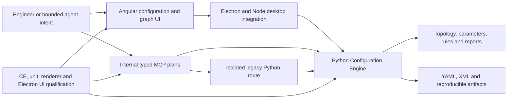

# Interconnect Architect contribution research

Reviewed 2026-10-27 for Michael Coulter. This report explains the investigation,
reconciliation and limits. [The achievement library](interconnect-architect-contributions.md)
contains 27 concise bullets, 27 expanded alternatives and 27 technical narratives.
The normalized JSON records remain the authoritative fact/retrieval layer.

## Scope and method

The product checkout was read at
`/Users/miccou01/GitProjects/sysip_shared_ai/workspaces/ideas/slot_04/checkout`,
branch `master`, HEAD `e24d80378096cb8d7a0ad87c20929cb520fa49d7`. It is not shallow.
All locally reachable refs were included. No fetch, branch change, product edit,
build/test execution, remote acceptance, publication or outside upload occurred.
The product worktree was clean before and after inspection.

| History measure | Selected HEAD | All local refs |
| --- | ---: | ---: |
| Michael-authored commits | 1,029 | 1,309 |
| Nonmerge / merge | 986 / 43 | 1,261 / 48 |
| Distinct nonmerge Change-Ids | 947 | 988 |
| Nonmerge commits without Change-Id | 18 | 20 |

The repository contains 11,987 total locally reachable commits. Michael's matched
Git identity is `Michael Coulter <michael.coulter@arm.com>`; author dates span
2021-11-04 through 2026-10-05. These are contribution-evidence dates, not employment,
formal-title, leadership-start or shipped-release dates. Local refs do not prove
remote freshness or include unreachable/deleted Git objects.

Stable patch-ID inspection found 1,259 nonempty authored nonmerge patches and
1,025 distinct patch identities: 968 represented in HEAD and 57 absent. These
counts are **not accomplishment counts**. Branch alternatives, repeated review
Change-Ids, reapplications, squash differences and two stash-related objects need
separate interpretation. A separate committer search found 39 other-author
objects committed by Michael; they were not relabeled as his implementations.

The investigation combined whole-history metadata/changed-path triage with
representative deep review of 105 authored commits across 28 overlapping topics,
73 current-path snapshots covering 69 distinct paths, function-range inspection,
origin/rename history and surviving-line blame. Key implementation hunks were
reviewed; this is not a manual audit of every changed line in every commit.
Surviving-line counts do not measure lifetime contribution or ownership percentage.

## Architecture and use cases

The diagram describes component relationships, not sole authorship. Major use
cases are mesh/NoC configuration, hierarchy and port editing, routing/placement,
legacy-design migration, DRC/deadlock/latency investigation, saved-design comparison,
desktop qualification and bounded agent-assisted configuration.

Michael's strongest cross-layer work connects hardware meaning to UI state and
engine persistence. Examples include metadata-driven bitfields; logical topology
and physical placement; graph reconstruction with fidelity-aware repairs; scoped
routing/deadlock investigation; project/request ownership across asynchronous
responses; and capability-bound plan execution with durable continuation evidence.

## Evolution and contribution map

| Theme | Evolution and technical evidence | Normalized records |
| --- | --- | --- |
| Catalog interchange | 2022 XML/domain/protocol adapters, existing-YAML input, hashed imports and launcher diagnostics; legacy launcher deprecated in 2024 | `accomplishment-catalog-configuration-interchange` |
| Metadata controls | 2022 Angular form adapter; 2024 multi-bit and mode-dependent masks | `accomplishment-metadata-parameter-controls` |
| CMN GUI | 2022 scaffolding/API-backed rendering; 2023 hierarchy/group editing; 2025 tile/combined-mesh views; 2026 multiport and live-metadata regressions | `accomplishment-cmn-configuration-editor`, `leadership-cmn-gui` |
| NoC logical canvas | Original 2025 view and connectors; later classification, route state and shared semantics | `accomplishment-nci-original-canvas`, `accomplishment-shared-renderer-semantics` |
| Graphics performance | Frame batching, geometry caching, change-detection boundaries, observer cleanup, larger coordinates and CPU/headless compatibility | `accomplishment-canvas-performance` |
| Physical placement | Project-bound allocation, collisions/grid, existing-state reservations, grouping, die sizing and persistence | `accomplishment-physical-autoplacement` |
| Legacy migration | 2023 scripts → 2024 source architecture derivation → 2026 integrated graph/fidelity/DRC pipeline | `accomplishment-nic400-migration` |
| Guided configuration | Engine policy, product-specific constraints, persistent lifecycle, retirement and stale-context protection | `accomplishment-guided-noc-flow` |
| OWO configuration | Facade/models/matrix, topology/protocol/credits/alignment and checkpoint/recovery | `accomplishment-owo-wizard` |
| Diagnostics and routing | 2024 hierarchical DRC results; 2025 route and deadlock drilldown; metadata-backed latency and semantic/textual diffs | `accomplishment-structured-drc-diagnostics`, `accomplishment-mesh-deadlock-investigation`, `accomplishment-static-latency-reporting`, `accomplishment-semantic-configuration-diff` |
| Console and desktop reliability | Report/log integration, Python command serialization, load/request ownership and platform lifecycle | `accomplishment-configuration-console`, `accomplishment-desktop-async-correctness`, `skill-electron-desktop` |
| Test infrastructure | 2022 headless E2E; 2025 Playwright gate; 2026 metadata-sensitive tests, Electron-hosted Karma and focused verticals | `accomplishment-playwright-infrastructure`, `accomplishment-electron-karma` |
| Release and compatibility | Exact-review/branch installer rehearsal, isolated outputs, optional internal payload, staged API authority and explicit version policy | `accomplishment-isolated-installer-staging`, `accomplishment-product-version-policy` |
| Developer documentation | Metadata collector, renderer, curated narrative and source navigation; surrounding guards include scaffolding | `accomplishment-ia-source-aware-documentation` |
| Internal MCP | April 2026 introduction; typed plans, live schemas, transactional receipts/replay, fallback, dual runtime and distinct qualification tiers | `project-ia-mcp` and its six accomplishment records |
| Vector snapshots | 2023 SVG export and later dialog refinements; current renderer limitations documented | `accomplishment-canvas-vector-export` |

The technology evidence includes Angular forms/Material/CDK, TypeScript, RxJS,
Electron/Node/JavaScript, SVG/Pixi, Python, XML/CCXML/YAML/JSON, Playwright/Karma,
Jenkins/Groovy/Bash and MCP. These are demonstrated project contexts; no new skill
proficiency rating, certification or years-of-language-tenure claim was inferred.

## Attribution and factual reconciliation

| Issue | Treatment |
| --- | --- |
| CMN responsibility | Preserve explicit owner confirmation of sole CMN GUI-tooling responsibility. It does not confer sole ownership of the product, shared graphics, engine algorithms or IP. |
| Formal role | Preserve Senior Software Engineer since April 2023; CMN GUI Lead remains functional responsibility. |
| Shared graphics and fixtures | Use original diffs and current blame as context; retain substantive collaboration rather than claiming all current architecture. |
| OWO recovery | Michael's wizard/checkpoint/fingerprint work is distinguished from later colleague changes to full engine/undo restoration. |
| Deadlock detector | Credit routing/diagnostic UX; the underlying engine algorithm predates Michael's GUI work. |
| Static latency | Credit metadata/API and correctness improvements; supplied defaults have separate authorship. Distinguish pruned standalone script from still-active CE report. |
| Modern/legacy runtime | Replace the outdated note that sources had not been inspected with direct local source review; preserve earlier correspondence and qualified-version limits. |
| Catalog launcher | Preserve historical integration while recording later deprecation. |
| Vector export | Distinguish original SVG work from current conditional logical-mesh SVG export and other PNG paths; no universal Pixi vector claim. |
| Business/adoption history | Preserve owner-reported usage, customer-facing production and qualitative licensing context. Git cannot independently establish those outcomes; no new revenue/user/time-saving metric. |
| Existing career evidence | All 226 original facts, their statuses/visibility/text and original citations remain intact. Earlier analyses, clarifications, employment, education and unrelated projects are retained. |
| Overlap | Expand existing accomplishments; add separate entities only for six distinct missing contributions and one demonstrated desktop skill. Summary/detail facts and alternative bullets are not additive accomplishments. |

## Metrics and execution boundaries

| Figure | What the evidence establishes | What it does not establish |
| --- | --- | --- |
| 4,130/4,130 and 5/5 | Migration introduction commit reports valid corpus DRC-clean and curated invalid-input rejection | New execution, raw-log recovery or functional/RTL equivalence |
| Six repair iterations | Maximum bounded closure iterations in inspected migration code | Guaranteed convergence on every input |
| 64×64 | GUI coordinate/identifier support | A benchmarked 4,096-node workload or speedup |
| 51 spec files | Changed Angular source `.spec.ts` paths in one June 2026 change | 51 test cases, new passes or coverage percentage |
| 12 unit + five UI spec files | Changed source/UI spec paths in OWO introduction | All newly added files, total cases, coverage percentage or passes |
| 79 Guided executions | October 1 commit-reported executions across its four supported revisions | New execution here or universal family support |
| 132 UI / 105 CE / 522 Angular | Separate reported Guided vertical totals, with seven UI and nine CE skips; two renderer builds also reported | A single sum or a clean run with no skips |
| 92 / 5,063 / two | Historical real-engine contract/integration, non-live suite and bounded agent evaluations, respectively | 92 agent tasks, summed overlapping tiers, current broad scenario execution or a fleet benchmark |
| Rollback hash equality | Historical bounded evaluation reports restored YAML matching input | General fallback benchmark, universal rollback guarantee or fresh acceptance |

Raw historical result logs, quantitative rendering/placement improvements,
attributable customer impact, exact lead-role start, adoption counts and repeated
agent evaluation statistics remain gaps. The [open questions](open-questions.md)
identify useful follow-up evidence. Missing evidence is not proof of missing skill.

## Changes to this knowledge base

- Expanded 29 existing records and added six accomplishment records plus one
  Electron desktop skill record: **95 records and 304 facts**, up from 88/226.
- Added **78 reported facts** and direct implementation/history citations while
  preserving every original fact and owner confirmation.
- Registered eight private local research artifacts, including a preserved partial
  terminology correction: **34 total sources**.
- Added the 27-entry achievement library with public-fact references, multiple
  detail levels, positioning choices and carefully scoped quantified variants.
- Added navigation, evidence gaps and this reconciliation report. No schema,
  tooling implementation, legacy output or existing application file was changed.

## Evidence navigation

All artifacts below live in the immutable research capture directory. Source
registry fingerprints identify their exact bytes. Internal paths/code excerpts
are private research evidence, not résumé copy.

| Artifact | Purpose |
| --- | --- |
| [History inventory](../sources/originals/src-ia-git-history-2026-10-27/history-inventory.json) | All 1,309 authored commit metadata/messages, changed paths, local refs and scope |
| [Implementation excerpts](../sources/originals/src-ia-git-history-2026-10-27/implementation-evidence.md) | Selected historical changes, source paths, current line excerpts/hashes and attribution |
| [Ownership/review map](../sources/originals/src-ia-git-history-2026-10-27/ownership-and-review.json) | 105 selected commits, section locators, 73 snapshots and origin/blame context |
| [Focused source ranges](../sources/originals/src-ia-git-history-2026-10-27/focused-implementation-evidence.md) | Command literals, diff, plans/receipts/fallback, sidecar, contracts, recovery and report logic |
| [Patch identities](../sources/originals/src-ia-git-history-2026-10-27/patch-identities.txt) | Stable patch equivalence; identities are not accomplishments |
| [Reviewed findings](../sources/originals/src-ia-git-history-2026-10-27/research-findings.md) | Challenges, personal actions, decisions, outcomes, limits and full commit/source anchors |
| [Final semantic review](../sources/originals/src-ia-git-history-2026-10-27/semantic-review-2026-10-27.md) | Partial correction of an unsupported acronym expansion; other findings preserved |
| [Historical results and attribution](../sources/originals/src-ia-git-history-2026-10-27/historical-results-and-attribution.md) | Exact reported baselines, predecessor authorship and other-author integration boundary |

Inspect a historical change with `git --no-optional-locks -C <product-checkout>
show <full-commit> -- <path>`. Historical paths may have moved or been removed;
current anchors and source hashes are separately identified. No remote URL was
invented or required for these local references.

## Validation and preserved application snapshots

The updated database passes `python3 scripts/career.py validate`: 95 records,
304 facts, 34 sources; source identities and citation bounds pass. `duplicates`
finds no exact duplicate fact text, and `git diff --check` passes. The 14 existing
standard-library tooling regression tests pass; they exercise the career tooling
with synthetic/temp data, not employer software.

A local evidence check resolves all 1,309 inventoried commit objects, verifies all
73 current snapshot hashes/paths against the unchanged product HEAD, checks all
original facts/citations are preserved and checks the achievement library's fact
references for public confirmed/reported eligibility. A separate semantic review
checks wording, scope, ownership, dates and metric categories. Structural success
alone does not prove semantic correctness or independent employer verification.

The preserved fictional-job example under
`applications/example-labs/staff-ai-developer-tools/2026-10-27/` now reports
**application trace drift** (`claims.json`) because supporting record evidence and
the registry changed. Its résumé, selection and prior outputs were preserved.
It requires a deliberate reviewed revision/refresh before claiming a current
passing audit; it was not silently rebuilt. Earlier legacy outputs remain
historical snapshots. No PDF/DOCX export, visual QA or live product acceptance is
claimed by this research.
