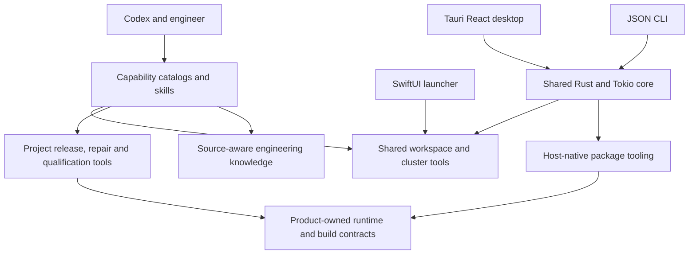

# Shared coding-agent engineering platform: research and reconciliation

Reviewed for Michael Coulter on 2026-10-29. This report complements the
[achievement library](shared-ai-contributions.md), existing AI project/accomplishment
records, and the preserved `AI-System-resume.md` supplied analysis. It extends that
analysis with direct local implementation/history evidence rather than replacing it.

## Scope, attribution and evidence

The inspected repository is `/Users/miccou01/GitProjects/sysip_shared_ai`, at
`e447aa84b06f5cea810d017942dbea1a4e26e451`, branch `main`, non-shallow.
The root `workspaces/` directory was excluded completely, including from source
collection and patch extraction. References to workspace paths inside manager
source are implementation evidence, not inspection of those checkouts.

Michael explicitly attributes all authored project content and engineering work in
this repository to himself regardless of author/committer metadata. The dated
statement is `src-shared-ai-owner-scope-2026-10-29`. Git authorship is retained as
historical context, not an attribution filter. This does not imply authorship of
Codex, models, dependency libraries, external MCP services, or product algorithms in
excluded repositories. Existing owner confirmations of adoption, responsibilities
and impact remain separately cited.

| Coverage | Captured scope |
| --- | --- |
| Locally reachable history | All 44 commits, March 27–October 5, 2026; complete local patch stream excluding `workspaces/` |
| Current project corpus | 345 tracked/nonignored files plus three ignored authored build-helper files; 348 fingerprints |
| Source/text snapshots | 294 current text files, plus 24 historical MCP files; 318 path/ref entries in the capture map |
| Other indexed files | Binary assets and lockfiles fingerprinted without reproducing their contents as accomplishments |
| Current work in progress | 61 modified tracked files and 39 untracked files; no staged changes at capture |
| Additional local metadata | Three ignored editor configuration fingerprints; configuration values not collected |
| Nested repositories | No additional Git root found outside excluded/generated/dependency areas; root workspaces excluded |
| Retained operational evidence | Fifteen publication manifests, three repair sessions and selected replay summaries, one interrupted coverage run, one product-work report |

The source index, history inventory, full local patch stream, current working-tree
patch, source map, grouped source captures and sanitized historical outcome extract
are registered in `sources/registry.json`. Raw employer implementation captures are
under ignored `sources/private/shared-ai-review-2026-10-29/`; **back them up separately**.
A clone without these private files will fail source validation until they are
restored. No secrets or local environment values were intentionally collected.

This is systematic inventory/history coverage and deep review of implementation
paths, tests and contracts. It is not a claim of reading every dependency, compiled
bundle, Git object byte or transient log. Generated builds, duplicated packaged
source trees, caches, screenshots/icons and lock entries do not establish separate
accomplishments. The ignored local build helper was examined as source; its target
copies were not traversed. Bootstrap discovery was not invoked because its source
scans workspace instructions, which would cross the explicit exclusion.

No source edit, fetch, checkout change, test/build, package execution, environment
activation, service start, registration, SSH/SMB operation, publication or upload was
performed in shared-AI. No résumé application was regenerated. Existing reviewed
applications retain their historical inputs and expected evidence-registry drift.

## Purpose and architecture

The repository turns recurring engineering tasks into discoverable, contextualized
Codex workflows backed by executable local tools. Its layers separate capability
metadata and instructions, shared workspace/cluster infrastructure, native user
interfaces, project-specific release/test tools, and durable engineering knowledge.
The most developed project overlay supports Interconnect Architect; the other three
project manifests declare integration identities and requirements, not equivalent
completed feature sets.

The diagram describes implemented integration boundaries. It does not depict an
implemented general multi-agent scheduler: the root orchestrator, agent registry
and shared evaluation directories remain placeholders. The long staged multi-agent
workflow is an authored procedure with responsibilities and handoffs. Codex supplies
the model/tool execution loop.

Use cases include concurrent development sessions, selecting exact GUI tests from
an editor, running CPU/GPU development builds, inspecting Git state before actions,
building/verifying packaged tools, reconstructing failed Jenkins environments,
publishing modules through cluster infrastructure, and retaining source-verified
engineering lessons for future tasks.

## Engineering mechanisms and significance

| Area | Challenge and implementation | Practical capability and boundary |
| --- | --- | --- |
| Capability discovery | Metadata contracts, project aliases, path/mode/content fingerprints, coordinated Markdown/JSON freshness, prerequisite checks and transactional skill links | Makes tools discoverable and installation reviewable; catalog presence is not live health |
| Workspace lifecycle | Manifests and project hooks, task context separate from runtime state, derived ports/caches/browser/editor profiles, guarded Git preparation, archive/restore history | Supports parallel sessions without sharing ordinary runtime state; task archive is metadata movement, not a Git snapshot |
| Concurrent allocation | Atomic directory locks, opaque token leases, paired records, Git-visible untracked markers and ownership-aware cleanup | Refresh/release require matching tokens; expired recognized untracked markers can be reclaimed without proving the original session stopped; ambiguous state is preserved |
| Native interfaces | SwiftUI/AppKit launcher; Tauri 2 React/TypeScript UI over the same Rust/Tokio core as a JSON CLI | Shared engineering operations remain consistent across surfaces; renderer development actions have a macOS-specific backend |
| Git inspection | NUL-delimited porcelain-v2 parsing, upstream-aware/freshness-labeled comparisons, four-task async bound, stable result ordering and reset rechecks after fetch | Handles renames/conflicts/Unicode and stale remote evidence without pretending unknown state is safe; no latency benchmark |
| Registered actions | Validated IDs/slots/placeholders/environment/timeouts, argument-array launch and explicit trusted shell mode | Gives tools a controlled execution contract; this is not an OS sandbox |
| Packaged processes | Atomic persistent registry, independent jobs, startup monitoring recovery, state events and PID/start-time/executable checks | Monitoring reattaches to recorded jobs without restarting commands or recovering original child exit status; a persistence failure terminates the newly untracked job |
| Historical MCP host | Pydantic-derived call signatures, SDK-version adaptation, tool/resource/prompt descriptors, sync/async dispatch, compatibility checks and trace records | Demonstrates protocol/runtime integration before product consolidation; descriptor approval is not authenticated human consent |
| Cluster access | Reusable noninteractive SSH/TTY controls, temporary askpass helpers, OS/load host advice and guarded SMB operations | Supports automation across configured environments; 35 hosts is configured scope, not a measured capacity result |
| Cross-site transfer | Run-owned partial names, source/destination SHA-256, matching-file reuse, conflict refusal and no-clobber finalization | Protects artifact identity and existing destinations; retries restart rather than resume bytes |
| Jenkins repair | Per-cell metadata/log/JUnit reconstruction, exact source revision and LSF constraints, alternate-index binary patches, file/mode/link/deletion inventories and latest-patch gates | Connects diagnosis, patch generation, synchronization and reviewable evidence; source fixes remain separate from commit/push |
| Matrix-change validation | Changes to matrix/pipeline selection require cluster validation of the updated matrix, beyond captured failed-only selections | Prevents old test selections from certifying a changed routing contract |
| Publication | Persisted phase state, immutable identity checks, safe archive/link/dependency/source validation, verified transfer, LSF build/install, publication, propagation and acceptance | A resumable release state machine; completed historical phases retain their historical contract |
| Host-native modules | macOS/Windows builders, lightweight-runtime/full-app profiles, disposable source copies, dependency fingerprints, payload inventories, relocation checks and archive round trips | Provides no-overwrite local package identities and verification; not proof of identical rebuild bytes across hosts or cluster compatibility |
| Agent rehearsal | Blank session workspace/state, selected provider/auth projection, exact MCP registration, health/proof/handshake checks and zero remaining owner records | Tests packaged integration without ordinary task context; selected auth/home/system tools remain inputs, so not an air gap |
| Exact test selection | Public Playwright discovery, full-title regex escaping/anchoring, second discovery requiring the same test ID, cancellation on ambiguity/EOF | Prevents an editor choice from accidentally broadening into unrelated tests; selection itself is not test execution |
| Editor navigation | Git-aware multi-root indexing, remote URIs, frecency, symbols/locations and query-revision/picker identity checks | Late asynchronous lookups cannot overwrite a newer query; existing editor APIs remain external dependencies |
| Native display placement | AppKit/Accessibility coordinate conversion, usable viewport, fullscreen/transient-window handling and repeated bounds verification | Supports deterministic editor placement despite application window reflow; mocked definitions are not live multi-monitor validation |
| GUI qualification | Matrix expansion, static/build/unit/renderer gates, fingerprints, raw-artifact preservation, resumability and explicit incomplete states | Keeps coverage evidence tied to source and prevents incomplete/synthetic runs being labeled qualified |
| Isolated docs smoke | Root-anchored copy exclusions, Doxygen regeneration, existing mac builder, Electron IPC via CDP/WebSocket and packaged URL checks | Checks a real packaging boundary instead of source docs alone; local helper replaces its target and uses weaker process-pattern termination |
| Knowledge and integrations | Full-history capture, supersession, live source checks, authoritative routing, secret/transient exclusion and bounded read-only Jira/Confluence contracts | Makes recurring engineering context reusable; guidance about another repository does not prove authorship of its algorithms |

Direct implementation locators are attached to normalized facts. The private source
map translates each original file line to a fixed capture line; history references
use the captured Git object/path and patch stream. This avoids reliance on mutable
absolute paths as the sole evidence.

The main implementation entry points below are relative to the inspected source
root. Each is preserved in its named source group, with exact original-line to
capture-line translation in `src-shared-ai-source-map-2026-10-29`.

| Evidence group | Principal source entry points |
| --- | --- |
| `src-shared-ai-bootstrap-2026-10-29` | `runtime/bootstrap/bootstrap_core.py`: catalog construction, freshness, registration rollback |
| `src-shared-ai-workspaces-2026-10-29` | `runtime/workspace-manager/lib/workspace-manager-common.sh`, `bin/workspace-allocate`, `bin/task-archive`, `bin/task-restore`, `launcher-support/WorkspaceManagerLauncher.swift` |
| `src-shared-ai-workbench-2026-10-29` | `runtime/software-workbench/crates/core/src/{lib,git,actions,packaged,editor}.rs`, desktop `src/{App.tsx,api.ts}`, CLI `src/main.rs` |
| `src-shared-ai-historical-2026-10-29` | `972e3d2^:mcp-runtime/src/sysip_shared_ai_mcp/{host,models,plugin_loader,request_router,approval_gate,trace_audit,config_loader}.py` and historical tests |
| `src-shared-ai-cluster-2026-10-29` | SSH/host-advisor/storage shell tools; `tools/cluster-remote-copy/lib/cluster_remote_copy.py` |
| `src-shared-ai-repair-2026-10-29` | `projects/ideas/tools/jenkins-gui-repair/lib/jenkins_gui_repair.py` and fixture-backed tests |
| `src-shared-ai-publication-2026-10-29` | `projects/ideas/tools/create-module/lib/create_module.py`, `scripts/archive_validator.py` |
| `src-shared-ai-local-modules-2026-10-29` | `projects/ideas/tools/ideas-local-module/lib/ideas_local_module.py`, macOS/Windows builders and tests |
| `src-shared-ai-editor-2026-10-29` | Project runtime launch refresh/runner/reporter/picker; `tools/vscode-path-copy-shortcuts/{extension,path-values}.js` |
| `src-shared-ai-qualification-2026-10-29` | `projects/ideas/tools/ideas-gui-coverage/lib/ideas_gui_coverage.py` and tests |
| `src-shared-ai-isolated-docs-2026-10-29` | `.miccou01/build_isolated_mac.py`, companion documentation and tests |
| `src-shared-ai-architecture-knowledge-2026-10-29` | Project manifests, architecture/operating docs, capture/integration skills, project knowledge/workflows and MCP GUI proof scripts |

The display utility and its tests are in the Workbench group. Documentation-only
scope and external ownership boundaries apply even when a guide links an excluded
checkout. These source references identify reviewed implementation, not commands
to execute during a career-evidence review.

## Historical development

| Local milestone | Evidence and interpretation |
| --- | --- |
| `3cb45b8`, March 30 | Umbrella import includes project manifests, workspace lifecycle, Swift launcher, GUI/domain procedures and task structure. The import was squashed; earlier dates/ownership cannot be reconstructed from this publication alone. |
| `d746a9a`, April 21; `0b490cd`, April 30 | Typed MCP runtime, configuration/compatibility/approval/traces, connection wrappers and proof/test guidance. Historical host code is captured from `972e3d2^`. |
| April–May guidance commits | Regression-selection, packaging, checkpoint, canvas, conversion and legacy-runtime lessons accumulate in source-aware knowledge and skills. These are guidance contributions; external product implementation is separately evidenced. |
| `23599f1`, `fe17f75`, `962b77e` | Cluster storage, SSH, host advice and verified transfer evolve into reusable infrastructure. |
| `448a1d4`, `16805d9` | Editor launch inputs and exact Playwright selection develop beyond manually assembled commands. |
| `10a4c6d`, June 2 | Native workspace launcher adds independent renderer build/run/focus/kill operations. |
| `d636a0e`, September 2 | Concurrent checkout allocation adds locking, leases, visible reservations and recovery controls. |
| `7fd543a`, September 2 | Jenkins repair tools/skill integrate failed-cell reconstruction, patch handling and replay evidence. |
| `972e3d2`, September 2 | Bootstrap catalogs are added and duplicated shared MCP/runtime assets are consolidated under product ownership. Historical capability remains career evidence but is not current shared-host architecture. |
| `54ad85b`, September 5 | Guarded publication/rehearsal workflows enter the local history. Retained operational records can predate this commit; a commit date is not necessarily first use. |
| `ca41c05`, `7d7d27b`, September 5 | Rust/Tauri Workbench and capability registration integrate shared runtime tools. |
| September–October; current dirty tree | Guidance continues to evolve; local modules, packaged build/process controls, qualification orchestration, display placement and ignored docs helper are captured at their actual current state, including uncommitted work. |

The migration document names predecessor subtree hashes that are absent from local
Git objects. They are historical documentation, not recovered earlier history.
The complete 44-commit inventory retains smaller maintenance/documentation changes;
the table groups them by engineering significance rather than counting commits as
separate achievements. No remote freshness or unreachable-object completeness is
claimed.

## Outcomes and measurement discipline

* Existing owner-confirmed adoption by several engineers is preserved. No new exact
  user count, productivity percentage, cost saving or business/revenue attribution
  is established by source inspection.
* Fifteen retained publication manifests record four complete, ten failed and one
  artifact-rejected runs. The four complete July 31–August 5 runs record all 13
  phases complete, including acceptance. Later runs include publication followed
  by failed acceptance. This retained sample is not a release success-rate study
  or validation of the current acceptance contract.
* Repair session 1463 retains three distinct final LSF jobs for the same patch,
  each selecting one test and reporting one pass without skips/failures/timeouts.
  Log summaries agree. Finalized inventories cover three files and explicitly
  record no staging/commit. This supports a historical bounded repair example,
  not an overall repair rate or broad suite qualification.
* Session 1243 has a duplicate earlier replay entry and final summaries of three
  passed/one skipped. Do not sum entries into distinct-run counts or present
  return code zero as all selected tests passing. The original Jenkins `FAILURE`
  describes the starting build, not the later repair outcome.
* The retained coverage summary is `INTERRUPTED`, null outcome, 56 planned cells,
  15 failed/40 pending/1 running, and ineligible for qualification. Its manifest
  remains `RUNNING`. Preserve this inconsistency; neither file proves completed
  qualification or a coverage percentage.
* A retained product test-retirement report describes 122 removed dependency
  packages, 61 Mocha passes and 7,094 collected Playwright instances across 188
  files. The product source is excluded here, collection is not execution, and
  this is not promoted into a new independently verified accomplishment.

Python, Rust, Node/JavaScript, frontend and shell test implementations were
examined as verification infrastructure. Counts such as 18 bootstrap, 15 allocator,
52 repair, 57 publication, 78 local-module and 21 qualification Python definitions
describe test surface, not passing results. The exact-test picker includes eight
Node definitions; the ignored docs helper has eight Python definitions and display
placement has six. These are not summed with historical integration tiers.

## Reconciliation with the knowledge base

* Strengthened 20 existing AI project/accomplishment/leadership records with direct
  implementation evidence and mechanism/limitation facts, preserving the supplied
  analysis and owner statements. Added context to five existing skill records.
* Added two independently useful accomplishments: packaged-documentation smoke
  automation and native display placement with bounds checks. Their builder/editor/runtime
  dependencies remain related work, not newly claimed implementations.
* Preserved the distinction between historical MCP host and current product-owned
  runtime, procedure design and executable orchestration, package verification and
  executed acceptance, and configured matrix scope versus completed qualification.
* Corrected the AI project note that previously described all underlying code as
  uninspected: shared-AI is now directly reviewed; excluded product repositories
  remain outside this task. Previous IA/NoC studies are not relabeled as new work.
* Preserved formal title, functional GUI responsibility, prior adoption/impact
  confirmations, embedded/academic experience, and all original evidence/facts.
  New source review does not imply a promotion, precise project start or current
  employment confirmation.

The key remaining gaps are current packaged/cluster acceptance, full GUI
qualification, complete predecessor history, dated release status for uncommitted
features, and measured user/time/performance outcomes. See
[open questions](open-questions.md). No hypothesis or missing metric is used to
inflate the application-ready achievements.

## Validation and preservation

Final structural/source validation passes with **105 records, 375 facts and 61
registered sources**. The duplicate checker reports no exact duplicate facts;
semantic review removed a redundant new exact-selection fact in favor of stronger
citations on the existing selection/ambiguity facts. Pre-commit review also clarified
expiry-based reservation reclamation and restart recovery of build monitoring.
It also distinguished shell/argument tests and static source assertions from native
window-placement execution. All 103 prior records, all 342 prior facts and their
citations, and all 39 prior source registrations are
preserved. Local document links and achievement fact references resolve.

Static preservation checks verified all 318 source/capture line mappings, all 348
indexed source fingerprints, three additional editor fingerprints, and unchanged
source HEAD, refs and complete working-tree status. `git diff --check` passes for
the knowledge-base changes. These checks support source identity and consistency;
they do not establish new employer test passes or operational acceptance. No schema
or career-tooling implementation changed, so unrelated tool tests and historical
application builds were not rerun. This section records the content review before
the user-authorized commits; Git history records the resulting revisions.
